# 3. Build the Robot URDF

A simulator can only train a controller for the robot it is given. In this chapter you describe the
real robot in a **URDF** (Unified Robot Description Format) file: what its parts are, how they are
connected, and how heavy they are. The better this file matches the real robot, the better the
trained policy will transfer.

!!! abstract "Learning objectives"
    - Understand links, joints and frames in a URDF.
    - Build the robot part by part in VS Code, checking each step in a live 3D preview.
    - Add collision shapes and compute the inertia of each part.

You will create **one new file** in your project:

```text
~/SelfBalancing/assets/SelfBalancingRobot.urdf   NEW
```

## 3.1 URDF in one minute

A URDF is an XML file with two kinds of elements:

- A **link** is a rigid part. It has a `<visual>` (what you see), a `<collision>` (what touches
  other things) and an `<inertial>` (mass, center of mass, inertia tensor).
- A **joint** connects a parent link to a child link. Its `<origin>` places the child frame relative
  to the parent frame, and its `type` says how the child can move: `fixed` (welded),
  `continuous` (rotates forever, like a wheel), `revolute` (rotates within limits), and so on.

The links form a tree with one root. For this robot the root is `base_link`, the chassis.

**Frame convention used everywhere in this project:** X points forward, Y points to the robot's
left, Z points up. Distances are in meters, masses in kilograms, angles in radians.

You will build the file in three passes: first the **visual** shapes (to see that every part is in
the right place), then the **collision** shapes, then the **inertia**.

## 3.2 Measure the real robot

Before writing anything, measure:

1. **Mass of each part** with a kitchen scale: chassis plate, upper plate, battery pack, each motor,
   each wheel. Small items (screws, wires, the ESP32) can be added to the part they sit on.
2. **Size of each part** (a bounding box is enough for a box-shaped part, radius and width for a
   wheel).
3. **Position of each part** relative to the chassis: how high the upper plate is, how far apart the
   wheels are, how far the wheel axle is below the chassis.

For this robot:

| Part | Link | Shape | Size (m) | Mass (kg) |
|---|---|---|---|---|
| Lower chassis | `base_link` | box | 0.120 × 0.200 × 0.075 | 0.300 |
| Upper plate | `upper_base_link` | box | 0.113 × 0.185 × 0.055 | 0.235 |
| Battery pack | `battery_link` | box | 0.081 × 0.076 × 0.020 | 0.215 |
| Motor (×2) | `motor1`, `motor2` | box | 0.040 × 0.056 × 0.047 | 0.170 each |
| Wheel (×2) | `wheel1`, `wheel2` | cylinder | r = 0.034, width = 0.026 | 0.035 each |

Total: about 1.16 kg.

!!! tip "Why boxes and cylinders instead of the CAD meshes?"
    A URDF can also be exported from CAD (e.g. the SolidWorks URDF exporter), with the real part
    shapes as STL meshes. Simple shapes are used here because every mass and inertia is written by
    hand from real measurements (CAD exports often get these wrong, for example when parts have no
    material assigned), and primitive shapes make collision checking cheaper and more stable. For
    balancing, what matters is the mass distribution, not how the robot looks.

## 3.3 Set up the editor

Install VS Code if you do not have it yet:

```bash
sudo snap install code --classic
```

Install the **URDF Visualizer** extension: open the Extensions view (`Ctrl + Shift + X`), type
`URDF Visualizer`, and click **Install**.

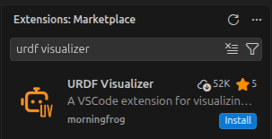

Create the `assets` folder in your project and open it in VS Code:

```bash
mkdir -p ~/SelfBalancing/assets
code ~/SelfBalancing/assets
```

In VS Code, create a new file named **`SelfBalancingRobot.urdf`** in it.

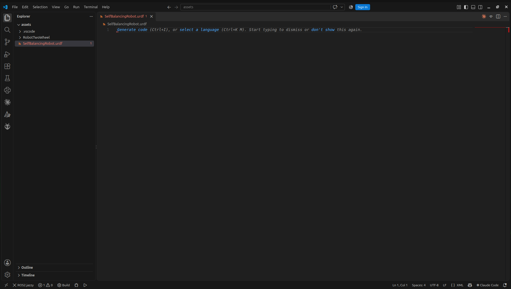

Click the **eye** icon at the top right of the editor to open the URDF preview next to your file.
Every time you save, click **Reload** in the preview to see your changes.

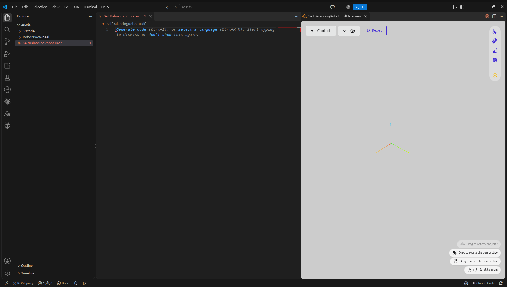

## 3.4 Build the visual model, part by part

### The robot tag

Every part of the robot is described inside a `<robot>` tag. Start the file with:

```xml
<?xml version="1.0" encoding="utf-8"?>
<robot name="SelfBalancingRobot">
</robot>
```

All the following snippets go **between** `<robot ...>` and `</robot>`.

### The chassis: `base_link`

```xml
    <link name="base_link">
        <visual>
            <origin xyz="0 0 0.0375" rpy="0 0 0" />
            <geometry>
                <box size="0.120 0.2 0.075" />
            </geometry>
            <material name="">
                <color rgba="0.89412 0.89412 0.89412 0.8" />
            </material>
        </visual>
    </link>
```

The box is 0.075 m tall. Its `<origin>` is raised by half of that (0.0375 m), so the box sits **on
top of** the link frame: the frame of `base_link` is at the bottom of the chassis. Save, click
**Reload**, and a box appears.

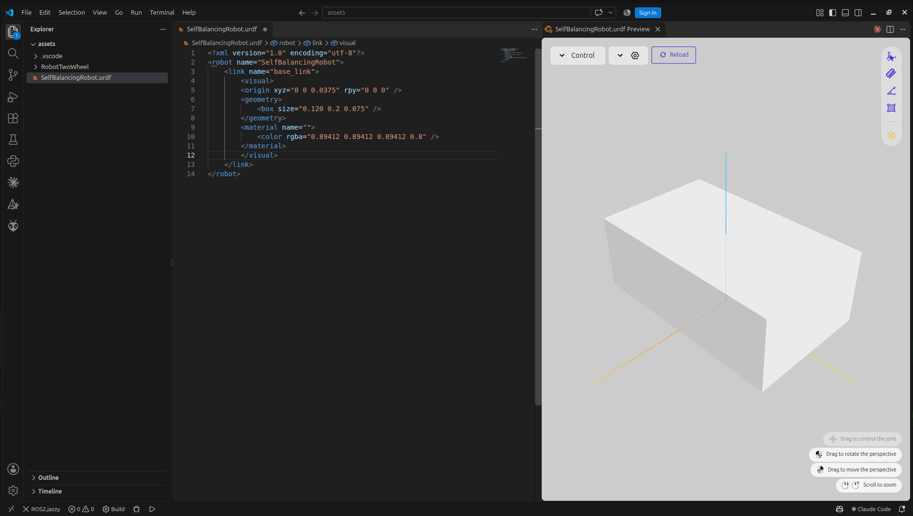

### The upper plate: a link and a joint

Add the upper plate:

```xml
    <link name="upper_base_link">
        <visual>
            <origin xyz="0 0 0" rpy="0 0 0" />
            <geometry>
                <box size="0.113 0.185 0.055" />
            </geometry>
            <material name="">
                <color rgba="0.89412 0.89412 0.89412 0.8" />
            </material>
        </visual>
    </link>
```

Reload: the upper plate is in the wrong place. Don't worry — a link is only placed once a **joint**
connects it to its parent. Add a fixed joint, first with a zero offset:

```xml
    <joint name="upper_base_joint" type="fixed">
        <origin xyz="0 0 0" rpy="0 0 0" />
        <parent link="base_link" />
        <child link="upper_base_link" />
        <axis xyz="0 1 0" />
    </joint>
```

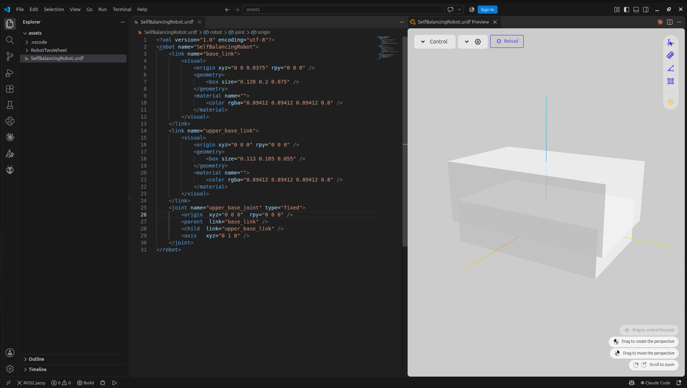

It is still in the wrong place: with `xyz="0 0 0"` its center is at the bottom of the chassis. Change
the joint origin to `xyz="0 0 0.1025"` (the real height of the plate's center above the bottom of the
chassis) and reload:

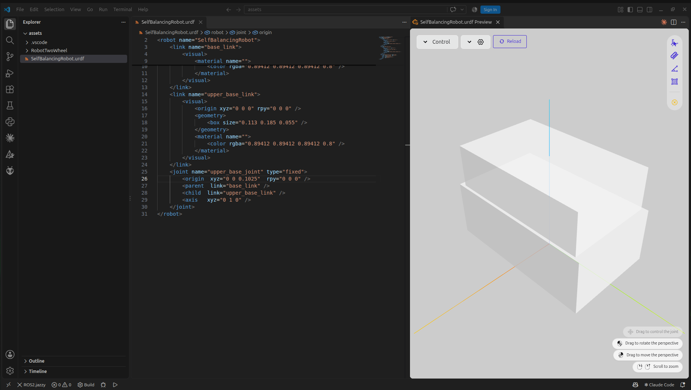

This is the pattern for every remaining part: add the **link**, then the **joint** that places it,
then adjust the joint origin until the preview matches the real robot.

### The battery pack

```xml
    <link name="battery_link">
        <visual>
            <origin xyz="0 0 0" rpy="0 0 0" />
            <geometry>
                <box size="0.081 0.076 0.02" />
            </geometry>
            <material name="">
                <color rgba="0.89412 0.89412 0.89412 0.8" />
            </material>
        </visual>
    </link>
```

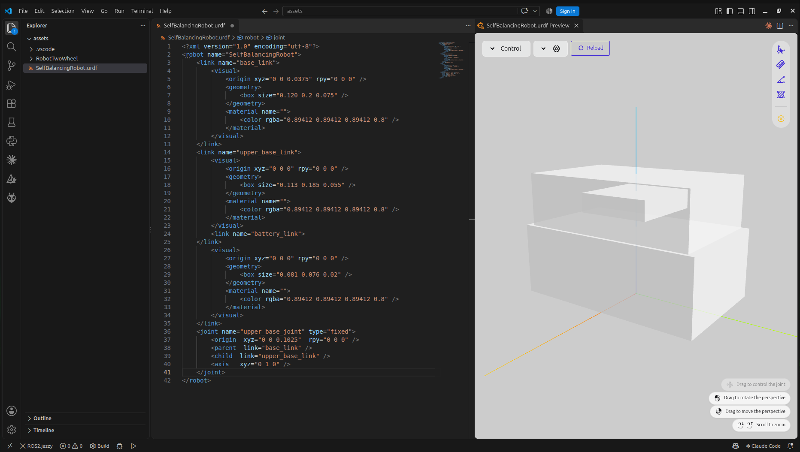

The battery hangs under the upper plate, so its parent is `upper_base_link`:

```xml
    <joint name="battery_upper_joint" type="fixed">
        <origin xyz="0 0 -0.01750" rpy="0 0 0" />
        <parent link="upper_base_link" />
        <child link="battery_link" />
        <axis xyz="0 1 0" />
    </joint>
```

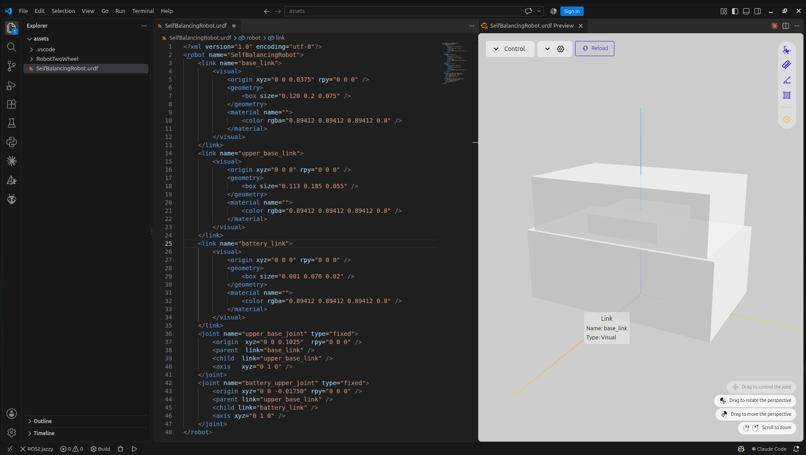

### The two motors

```xml
    <link name="motor1">
        <visual>
            <geometry><box size="0.040 0.056 0.047" /></geometry>
            <origin xyz="0 0 0" rpy="0 0 0" />
            <material name="gray" />
        </visual>
    </link>
    <link name="motor2">
        <visual>
            <geometry><box size="0.040 0.056 0.047" /></geometry>
            <origin xyz="0 0 0" rpy="0 0 0" />
            <material name="gray" />
        </visual>
    </link>
```

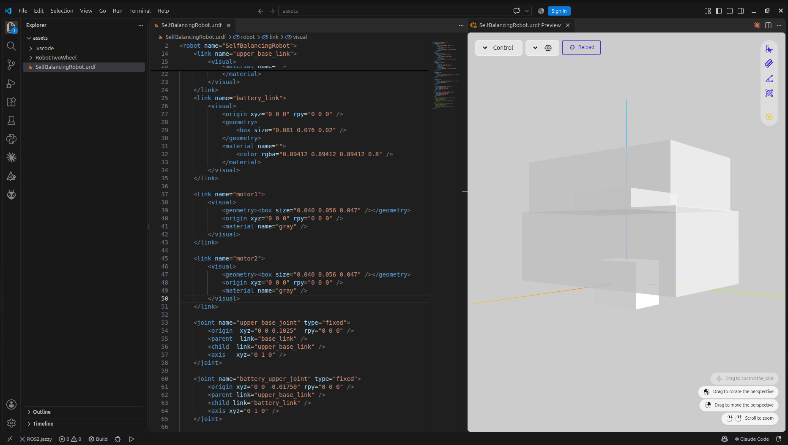

`motor1` is on the left (+Y), `motor2` on the right (−Y), both 0.0235 m below the bottom of the
chassis:

```xml
    <joint name="motor1_base_joint" type="fixed">
        <parent link="base_link" />
        <child link="motor1" />
        <origin xyz="0 0.072 -0.0235" rpy="0 0 0" />
        <axis xyz="1 0 0" />
    </joint>
    <joint name="motor2_base_joint" type="fixed">
        <parent link="base_link" />
        <child link="motor2" />
        <origin xyz="0 -0.072 -0.0235" rpy="0 0 0" />
        <axis xyz="1 0 0" />
    </joint>
```

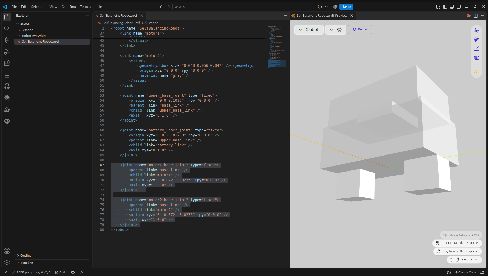

### The two wheels

A URDF cylinder's axis is its local Z. A wheel must spin about Y, so its geometry is rotated by 90°
about X (`rpy="1.5707 0 0"`):

```xml
    <link name="wheel1">
        <visual>
            <geometry><cylinder radius="0.034" length="0.026" /></geometry>
            <origin xyz="0 0 0" rpy="1.5707 0 0" />
            <material name="gray" />
        </visual>
    </link>
    <link name="wheel2">
        <visual>
            <geometry><cylinder radius="0.034" length="0.026" /></geometry>
            <origin xyz="0 0 0" rpy="1.5707 0 0" />
            <material name="gray" />
        </visual>
    </link>
```

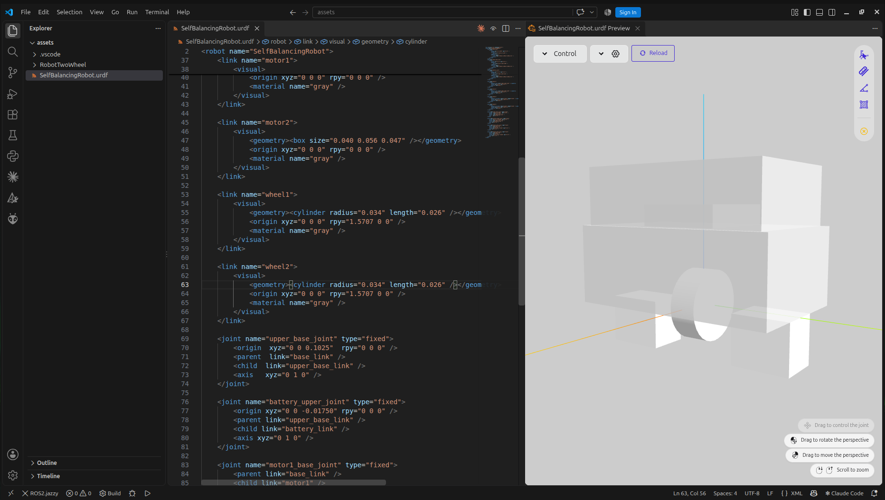

The wheel joints are the only moving joints: `continuous`, rotating about Y (`axis xyz="0 1 0"`):

```xml
    <joint name="wheel1_motor1_joint" type="continuous">
        <parent link="motor1" />
        <child link="wheel1" />
        <origin xyz="0 0.053 -0.0105" rpy="0 0 0" />
        <axis xyz="0 1 0" />
    </joint>
    <joint name="wheel2_motor2_joint" type="continuous">
        <parent link="motor2" />
        <child link="wheel2" />
        <origin xyz="0 -0.053 -0.0105" rpy="0 0 0" />
        <axis xyz="0 1 0" />
    </joint>
```

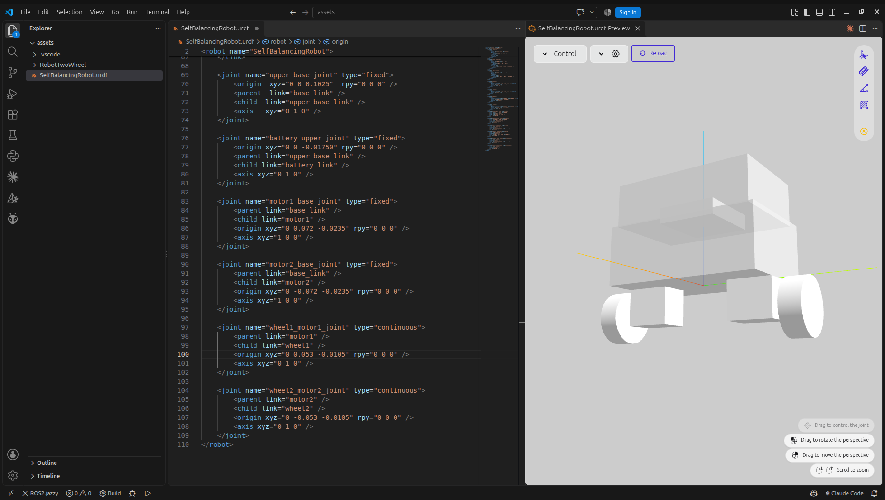

The visual model is complete. The joint tree you built is:

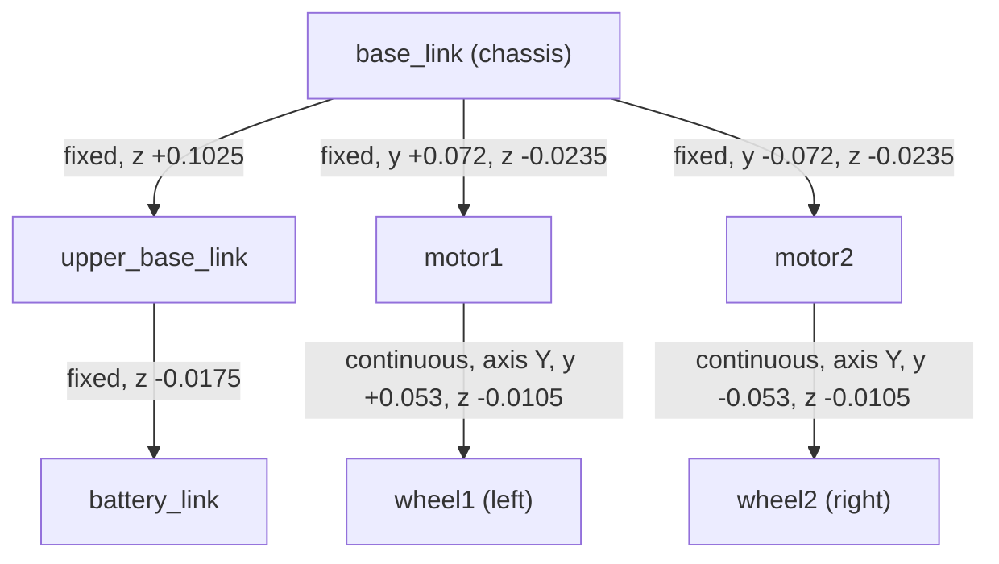

!!! important "Remember the wheel order and sign"
    `wheel1` is at +Y, so it is the **left** wheel; `wheel2` is the right wheel. With
    `axis="0 1 0"`, a positive wheel velocity rolls the robot forward (+X). The firmware in chapter 8
    must use the same left/right order and the same sign.

## 3.5 Add the collision shapes

The physics engine does not use `<visual>`; contacts are computed with `<collision>`. For each link,
add a `<collision>` block with the **same** `<origin>` and `<geometry>` as its visual. For example,
`base_link` becomes:

```xml
    <link name="base_link">
        <visual>
            <origin xyz="0 0 0.0375" rpy="0 0 0" />
            <geometry>
                <box size="0.120 0.2 0.075" />
            </geometry>
            <material name="">
                <color rgba="0.89412 0.89412 0.89412 0.8" />
            </material>
        </visual>
        <collision>
            <origin xyz="0 0 0.0375" rpy="0 0 0" />
            <geometry>
                <box size="0.120 0.2 0.075" />
            </geometry>
        </collision>
    </link>
```

Do this for all 7 links, then reload. Open the **Control** menu of the preview and tick **Show
Collision**:

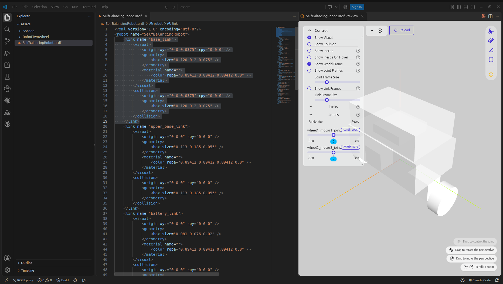

The collision shapes are drawn in yellow. If they cover the visual shapes exactly, they are correct:

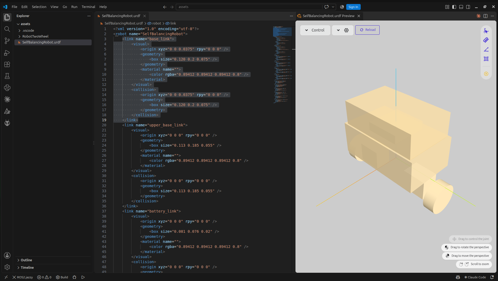

## 3.6 Add the inertia

Each link needs an `<inertial>` block: its mass, the position of its center of mass, and its
**inertia tensor**, which describes how hard it is to rotate the part about each axis. For a uniform
solid part, about its own center (see also the
[list of moments of inertia](https://en.wikipedia.org/wiki/List_of_moments_of_inertia)):

=== "Box (size x × y × z)"

    $$
    I_{xx} = \tfrac{m}{12}(y^2 + z^2), \quad
    I_{yy} = \tfrac{m}{12}(x^2 + z^2), \quad
    I_{zz} = \tfrac{m}{12}(x^2 + y^2)
    $$

=== "Cylinder (radius r, length h, axis along z)"

    $$
    I_{xx} = I_{yy} = \tfrac{m}{12}(3r^2 + h^2), \quad
    I_{zz} = \tfrac{m}{2} r^2
    $$

A small script avoids arithmetic mistakes:

```python
def box(m, x, y, z):
    return dict(ixx=m / 12 * (y**2 + z**2), iyy=m / 12 * (x**2 + z**2), izz=m / 12 * (x**2 + y**2))

def cylinder(m, r, h):
    side = m / 12 * (3 * r**2 + h**2)
    return dict(ixx=side, iyy=side, izz=m / 2 * r**2)

print("base_link      ", box(0.300, 0.120, 0.200, 0.075))
print("upper_base_link", box(0.235, 0.113, 0.185, 0.055))
print("battery_link   ", box(0.215, 0.081, 0.076, 0.020))
print("motor          ", box(0.170, 0.040, 0.056, 0.047))
print("wheel          ", cylinder(0.035, 0.034, 0.026))
```

The off-diagonal terms (`ixy`, `ixz`, `iyz`) are 0 for a box or cylinder aligned with its frame. The
`<inertial>` origin is the part's center, the same as its visual origin (including the `rpy` of the
wheels). Add the block at the top of each link, for example:

```xml
    <link name="base_link">
        <inertial>
            <origin xyz="0 0 0.0375" rpy="0 0 0" />
            <mass value="0.3" />
            <inertia ixx="1.140625E-03" ixy="0.0" ixz="0.0"
                     iyy="5.0063E-04" iyz="0.0" izz="1.36E-03" />
        </inertial>
        <visual>
            ...
        </visual>
        <collision>
            ...
        </collision>
    </link>
```

Reload and tick **Show Inertia** in the Control menu. Each part with a correct inertia shows a green
box of about its own size and position:

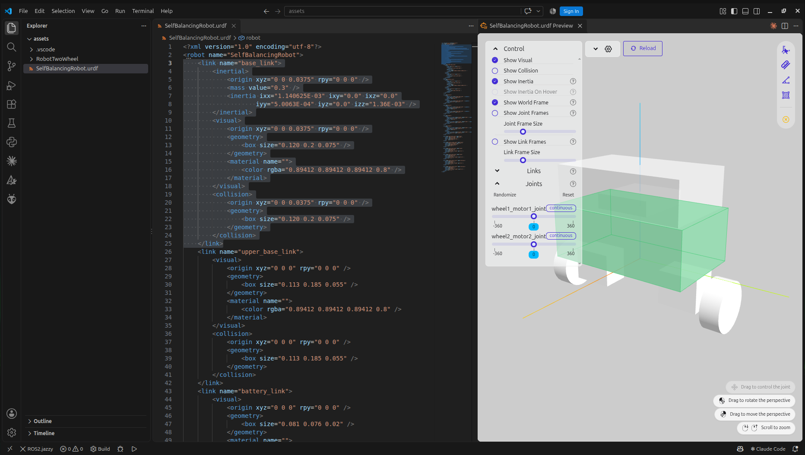

!!! tip "Small differences are normal"
    The script gives the exact values; the file below uses them rounded to 4–5 significant digits.

## 3.7 Check the ground clearance

Add up the vertical offsets from `base_link` down to the bottom of a wheel:

| Step | Offset (m) |
|---|---|
| `base_link` → motor | −0.0235 |
| motor → wheel center | −0.0105 |
| wheel center → bottom of wheel (radius) | −0.0340 |
| **Total** | **−0.0680** |

So when the wheels rest on the ground, `base_link` is 0.068 m above it. Chapter 4 spawns the robot at
0.070 m, a 2 mm margin so the wheels drop onto the ground instead of starting inside it.

## 3.8 The complete file

Compare your file with the complete one below (or copy it), and save it as
`~/SelfBalancing/assets/SelfBalancingRobot.urdf`:

??? example "`assets/SelfBalancingRobot.urdf` (complete file)"

    ```xml
    --8<-- "docs/code/assets/SelfBalancingRobot.urdf"
    ```

[:material-download: Download the file](code/assets/SelfBalancingRobot.urdf){ .md-button download }

!!! tip "Building your own robot?"
    Keep the structure (root `base_link`, fixed links merged into it, two `continuous` wheel joints
    about Y, left wheel at +Y) and replace the sizes, masses, inertias and joint offsets with your
    own measurements.

!!! success "Checkpoint"
    The preview shows the complete robot, the collision shapes cover the visual shapes, every part
    shows a green inertia box, and the masses add up to the real robot's weight.
